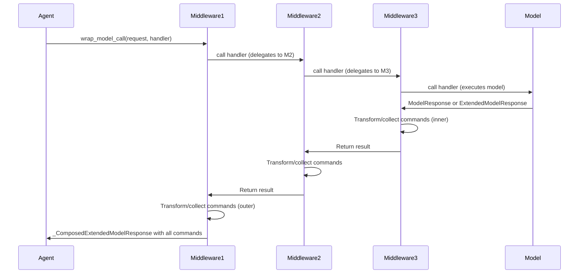

## Overview

Middleware in LangChain agents provides a composable, layered approach to intercepting and modifying agent behavior without changing core agent logic. Middleware hooks into the agent execution loop to implement cross-cutting concerns: automatic retries, error handling, human-in-the-loop approval, tool argument validation, structured output transformation, and tool caching.

### Core Architectural Principles

**Interception Model**: Each middleware instance registers sync/async handler pairs for lifecycle hooks. When the agent executes, hooks are invoked in registration order, with each middleware observing or transforming state before delegating to the next layer or the core execution logic.

**Composition Semantics**: Middleware registered first in the list becomes the outermost layer. When composing `wrap_model_call` or `wrap_tool_call` handlers, each middleware wraps the previous ones, establishing a chain where the first middleware intercepts first and last.

- **Model call stack example**: `[Middleware1, Middleware2, Middleware3]` becomes `Middleware1(Middleware2(Middleware3(model)))`, so `Middleware1` receives control first, calls the next handler (which is Middleware2's wrapper), receives the result, and can transform it before returning.
- **Tool call stack**: Identical composition order — first middleware is outermost.

**State and Command Flow**: Most hooks return optional state updates (`dict[str, Any]`). The `wrap_model_call` and `wrap_tool_call` interception points also support returning `Command` objects from LangGraph, allowing middleware to redirect execution or jump to different nodes (e.g., skip tool execution, loop back to model, or exit).

## AgentMiddleware Protocol

All middleware classes inherit from `AgentMiddleware`, a generic base that defines optional hooks and establishes the contract for interceptors.

### Type Parameters

```python
class AgentMiddleware(Generic[StateT, ContextT, ResponseT]):
    """
    StateT: Type of agent state (default: AgentState[Any]).
    ContextT: Type of runtime context (default: None).
    ResponseT: Type of structured response (default: Any).
    """
```

### Lifecycle Hooks

Middleware can implement any or all of these lifecycle methods; unimplemented methods raise `NotImplementedError` if invoked in the wrong execution path (sync vs async):

#### Before/After Agent

Invoked once per agent execution—at the beginning and end of the full execution loop.

```python
def before_agent(self, state: StateT, runtime: Runtime[ContextT]) -> dict[str, Any] | None:
    """Runs once at the very start of agent execution, before the first model call.
    
    Useful for initializing state, logging, or validating inputs.
    """

async def abefore_agent(self, state: StateT, runtime: Runtime[ContextT]) -> dict[str, Any] | None:
    """Async version of before_agent."""

def after_agent(self, state: StateT, runtime: Runtime[ContextT]) -> dict[str, Any] | None:
    """Runs once after the agent loop terminates (no more tool calls or explicit exit).
    
    Useful for cleanup, final logging, or state consolidation.
    """

async def aafter_agent(self, state: StateT, runtime: Runtime[ContextT]) -> dict[str, Any] | None:
    """Async version of after_agent."""
```

#### Before/After Model

```python
def before_model(self, state: StateT, runtime: Runtime[ContextT]) -> dict[str, Any] | None:
    """Runs before each model invocation; allows state transformation before the call."""

async def abefore_model(self, state: StateT, runtime: Runtime[ContextT]) -> dict[str, Any] | None:
    """Async version of before_model."""

def after_model(self, state: StateT, runtime: Runtime[ContextT]) -> dict[str, Any] | None:
    """Runs after each model response; allows approval, modification, or rejection of tool calls."""

async def aafter_model(self, state: StateT, runtime: Runtime[ContextT]) -> dict[str, Any] | None:
    """Async version of after_model."""
```

#### Wrap Model Call (Core Interception)

```python
def wrap_model_call(
    self,
    request: ModelRequest[ContextT],
    handler: Callable[[ModelRequest[ContextT]], ModelResponse[ResponseT]],
) -> ModelResponse[ResponseT] | AIMessage | ExtendedModelResponse[ResponseT]:
    """Intercept and control model execution.
    
    The handler callback executes the model call and returns ModelResponse.
    Middleware can:
    - Call handler once for normal execution.
    - Call handler multiple times for retry logic.
    - Skip calling handler to short-circuit (return a cached result).
    - Modify request before calling handler.
    - Transform response after handler returns.
    
    Returns ModelResponse, AIMessage (auto-wrapped), or ExtendedModelResponse (with Command).
    """

async def awrap_model_call(
    self,
    request: ModelRequest[ContextT],
    handler: Callable[[ModelRequest[ContextT]], Awaitable[ModelResponse[ResponseT]]],
) -> ModelResponse[ResponseT] | AIMessage | ExtendedModelResponse[ResponseT]:
    """Async version of wrap_model_call."""
```

#### Wrap Tool Call (Tool Interception)

```python
def wrap_tool_call(
    self,
    request: ToolCallRequest,
    handler: Callable[[ToolCallRequest], ToolMessage | Command[Any]],
) -> ToolMessage | Command[Any]:
    """Intercept tool execution.
    
    Called once per tool call with the full ToolCallRequest (tool name, args, call id, state, runtime).
    Middleware can:
    - Call handler for normal execution.
    - Call handler multiple times for retries.
    - Skip handler to return a cached result or mock.
    - Modify tool args before handler.
    - Convert exceptions to error ToolMessages.
    
    Returns ToolMessage or Command.
    """

async def awrap_tool_call(
    self,
    request: ToolCallRequest,
    handler: Callable[[ToolCallRequest], Awaitable[ToolMessage | Command[Any]]],
) -> ToolMessage | Command[Any]:
    """Async version of wrap_tool_call."""
```

### Configuration

```python
class AgentMiddleware(Generic[StateT, ContextT, ResponseT]):
    state_schema: type[StateT] = AgentState[Any]
    """Optional custom state schema. Merged with base AgentState during graph compilation."""
    
    tools: Sequence[BaseTool] = ()
    """Additional tools registered by this middleware (e.g., ShellToolMiddleware adds shell_tool)."""
    
    trace_policy: TracePolicy | None = None
    """Optional trace policy controlling what is captured in spans for this middleware's hooks."""
    
    transformers: Sequence[TransformerFactory] = ()
    """Stream transformer factories for streaming customization."""
```

## Core Middleware Types and Patterns

### Model Execution Middleware

**ModelRetryMiddleware**: Automatically retries failed model calls with exponential backoff when transient errors (rate limits, API timeouts) occur. Supports custom exception filtering, custom failure handlers, and jitter to avoid thundering herd.

```python
from langchain.agents.middleware import ModelRetryMiddleware

retry = ModelRetryMiddleware(
    max_retries=3,
    retry_on=(RateLimitError, APITimeoutError),
    backoff_factor=2.0,
    initial_delay=1.0,
    on_failure="continue",  # or "error" to re-raise, or callable
)
```

**ModelFallbackMiddleware**: Wraps the primary model with a fallback model (typically smaller/faster/cheaper) when the primary fails or to diversify model selection strategies.

**ModelCallLimitMiddleware**: Enforces a maximum number of model calls per agent invocation, preventing runaway loops.

### Tool Execution Middleware

**ToolErrorMiddleware**: Converts tool execution exceptions (e.g., API errors, validation failures) into error `ToolMessage` objects sent back to the model, allowing the model to recover or clarify. Opt-in by exception type—unhandled exceptions propagate.

```python
from langchain.agents.middleware import ToolErrorMiddleware

def on_error(exc: Exception, request: ToolCallRequest) -> str | None:
    if isinstance(exc, ValueError):
        return f"Invalid argument for {request.tool_call['name']}: {exc}"
    if isinstance(exc, TimeoutError):
        return "Tool request timed out; please try again."
    return None  # Propagate exceptions you don't handle

middleware = ToolErrorMiddleware(on_error=on_error)
```

Key behaviors:
- Exceptions not handled by `on_error` propagate to the caller (not silently swallowed)
- LangGraph control-flow signals (interrupts, Commands) always propagate
- Only exceptions from tool *execution* are caught; argument validation errors are handled upstream
- Can provide both sync (`on_error`) and async (`aon_error`) handlers

**ToolRetryMiddleware**: Automatically retries failed tool calls with exponential backoff. Similar to `ModelRetryMiddleware` but for tool execution. Supports custom exception filtering and on-failure behavior.

```python
from langchain.agents.middleware import ToolRetryMiddleware

retry = ToolRetryMiddleware(
    max_retries=3,
    retry_on=(TimeoutError, ConnectionError),  # Retry only these
    backoff_factor=2.0,
    initial_delay=1.0,
    on_failure="error",  # Or "continue" to return error message, or custom callable
)
```

**ToolCallLimitMiddleware**: Prevents infinite tool loops by enforcing per-tool and global limits. Tracks call counts per agent run and per thread, with configurable exit behavior (block with error message, raise exception, or end agent immediately).

```python
from langchain.agents.middleware import ToolCallLimitMiddleware

limits = ToolCallLimitMiddleware(
    tools=["search"],  # Limit specific tools
    run_limit=5,       # Max 5 calls per agent invocation
    thread_limit=50,   # Max 50 calls per conversation thread
    exit_behavior="continue",  # Send error message, don't raise
)
```

### Control Flow & Approval Middleware

**HumanInTheLoopMiddleware**: Pauses after model-requested tool calls and sends an interrupt with action summaries to a human reviewer. Uses the `after_model` hook to intercept AIMessage tool calls and send a HITLRequest for review. Supports approval, editing, rejection, or human-answered "respond" decision types. Tool calls are modified based on human feedback before execution.

```python
from langchain.agents.middleware import HumanInTheLoopMiddleware

hitl = HumanInTheLoopMiddleware(
    interrupt_on={
        "delete_file": True,  # All decision types allowed
        "search": {
            "allowed_decisions": ["approve", "reject"],
            "description": "Searching online databases",
        },
    }
)
```

The middleware constructs `ActionRequest` objects (with name, args, and optional description) and `ReviewConfig` objects (with action name and allowed decision types), sends them as a `HITLRequest` via `langgraph.interrupt()`, receives decisions back, and processes them:
- **approve**: Tool call proceeds unchanged
- **edit**: Tool call arguments are revised by the human
- **reject**: Tool call is blocked; a ToolMessage with user feedback is sent to the model instead
- **respond**: Tool execution is skipped; a synthetic ToolMessage with the human's answer is returned to the model

### Data Transformation & Privacy Middleware

**PIIMiddleware**: Detects personally identifiable information (PII) in prompts, model responses, and tool outputs; optionally redacts or transforms it. Supports configurable detectors and redaction rules.

**ContextEditingMiddleware**: Allows dynamic modification of agent context (system message, available tools, or conversation history) during execution. Uses the `before_model` hook to intercept and modify the request before it reaches the model.

**FilesystemFileSearchMiddleware** (and **ProviderToolSearchMiddleware**): Integrates file/document search capabilities into the agent. Retrieves relevant documents or available tools before model calls, augmenting the context dynamically based on user queries.

### System Tools Middleware

**ShellToolMiddleware**: Registers a persistent `shell` tool that executes shell commands in a controlled environment. Supports multiple execution policies (HostExecutionPolicy, DockerExecutionPolicy, CodexSandboxExecutionPolicy) for sandboxing. Features include resource limits, timeout enforcement, output truncation, and optional redaction of sensitive data (PIIMatch).

```python
from langchain.agents.middleware import ShellToolMiddleware, HostExecutionPolicy

shell = ShellToolMiddleware(
    execution_policy=HostExecutionPolicy(),  # Or Docker/Codex
    timeout=30.0,                             # Command timeout
    output_max_chars=10000,                   # Truncate large outputs
)
```

**TodoListMiddleware**: Registers a persistent todo list tool, allowing the agent to create, manage, and track tasks across the conversation lifetime.

### Testing & Utility Middleware

**LLMToolEmulator**: Emulates tool execution using an LLM instead of invoking the actual tool. Useful for testing agent logic without calling real tools or for simulating tool behavior. Can emulate all tools or a selective list by name.

```python
from langchain.agents.middleware import LLMToolEmulator

# Emulate all tools for testing
middleware = LLMToolEmulator()

# Or emulate specific tools by name
middleware = LLMToolEmulator(tools=["get_weather", "search"])

# Or use a custom model for emulation
middleware = LLMToolEmulator(
    tools=["get_weather"],
    model="anthropic:claude-sonnet-4-5-20250929"
)
```

**LLMToolSelectorMiddleware**: Uses an LLM to intelligently filter the agent's available tools based on the current query. Reduces token overhead by only making relevant tools available for each request. Configured with tool selection criteria and fallback behavior on parsing failures.

**SummarizationMiddleware**: Automatically summarizes and compresses conversation history when approaching token limits. Uses a configurable summarizer model and trigger clauses to decide when to compress, helping agents maintain context in long conversations within token budgets.

## Request and Response Types

### ModelRequest

```python
@dataclass
class ModelRequest(Generic[ContextT]):
    """Request context for model execution."""
    
    model: BaseChatModel          # The model to invoke
    messages: list[AnyMessage]    # Messages (excluding system message)
    system_message: SystemMessage | None  # System instructions
    tool_choice: Any              # Tool selection strategy
    tools: list[BaseTool | dict]  # Available tools
    response_format: ResponseFormat[Any] | None  # Structured output format
    state: AgentState[Any]        # Full agent state
    runtime: Runtime[ContextT]    # Runtime context
    model_settings: dict[str, Any]  # Additional model parameters
```

**Immutable Pattern**: Middleware should not mutate `ModelRequest` directly. Use `request.override(**changes)` to create a new request with modifications. Direct attribute assignment is deprecated and raises `DeprecationWarning`.

### ModelResponse

```python
@dataclass
class ModelResponse(Generic[ResponseT]):
    """Successful model execution result."""
    
    result: list[BaseMessage]                  # Messages (typically one AIMessage)
    structured_response: ResponseT | None = None  # Parsed structured output
```

### ExtendedModelResponse

```python
@dataclass
class ExtendedModelResponse(Generic[ResponseT]):
    """Model response with optional LangGraph Command for additional state updates."""
    
    model_response: ModelResponse[ResponseT]
    command: Command[Any] | None = None
```

Middleware can return `ExtendedModelResponse` to apply a command that modifies state after the model node completes. Commands are applied through state reducers, so messages in commands are **added** to existing messages (not replaced). Non-reducer state fields in commands follow outermost-wins semantics: when multiple middleware return commands, the outermost middleware's values for non-reducer fields override inner ones, but `messages` fields accumulate.

### ToolCallRequest

```python
@dataclass
class ToolCallRequest:
    """Request context for tool execution."""
    
    tool_call: dict  # Tool call dict with 'id', 'name', 'args'
    tool: BaseTool | None  # Resolved BaseTool instance (or None in batch mode)
    state: AgentState[Any]  # Agent state at time of call
    runtime: ToolRuntime  # Runtime context with tool-specific info
```

**Modifying Tool Calls**: Like `ModelRequest`, `ToolCallRequest` provides an `override()` method to create a modified copy with changes to `tool_call` or `tool`. Use this to modify arguments or the tool itself without mutating the original.

```python
# Modify tool arguments before execution
modified_call = {
    **request.tool_call,
    "args": {**request.tool_call["args"], "query": "modified query"}
}
request = request.override(tool_call=modified_call)
```

### Extending Agent State with Custom Schemas

Middleware can extend the agent state with additional fields by defining a custom `state_schema`. This is useful for middleware that needs to persist intermediate computations, counts, or configuration across the agent loop.

```python
from typing_extensions import TypedDict, NotRequired, Annotated
from langchain.agents.middleware import AgentState, PrivateStateAttr

class MyCustomState(AgentState[Any]):
    """Extend AgentState with custom fields."""
    
    call_count: NotRequired[Annotated[int, PrivateStateAttr]]
    """Private field tracking calls; not exposed in input/output."""
    
    custom_data: NotRequired[str]
    """Public custom field; exposed in input/output schemas."""

class MyMiddleware(AgentMiddleware):
    state_schema = MyCustomState
    
    def before_agent(self, state: MyCustomState, runtime):
        if "call_count" not in state:
            return {"call_count": 0}
        return None
```

Middleware state fields marked with `PrivateStateAttr` are internal (not exposed in schemas). Use `@hook_config` or TypedDict annotations to control visibility.

## Composition and Execution Order



This diagram shows hook execution order and how commands accumulate through the stack.

### Middleware Stack Execution

When middleware is registered as `[M1, M2, M3]`:

**Model Call Stack**:
1. M1's `wrap_model_call` is entered first
2. M1 calls handler → M2's `wrap_model_call` is entered
3. M2 calls handler → M3's `wrap_model_call` is entered
4. M3 calls handler → actual model execution
5. M3 returns result to M2
6. M2 can transform result and returns to M1
7. M1 can transform result and returns to agent

**Result**: Innermost middleware (M3, closest to model) executes first; outermost (M1) sees and can override all inner results.

### State Updates and Commands

State updates from hooks are merged using LangGraph reducers. For the `messages` field (which uses `add_messages` reducer), updates accumulate rather than replace.

**Command Accumulation**: When middleware returns `ExtendedModelResponse` with `Command`, multiple commands are accumulated in a list (inner-to-outer order). The agent applies them sequentially after the model node completes through the LangGraph state reducer system.

**Reducer Semantics**: 
- **Messages field**: Uses `add_messages` reducer, so messages in commands are **added** to the existing message list rather than replacing it.
- **Non-reducer fields**: Later commands overwrite earlier ones (outermost middleware wins). This means if multiple middleware return commands with state updates to the same field (other than `messages`), the outermost middleware's value takes precedence.

Example: If M1 and M3 both return commands with `{"status": "value"}`, M1's value (outermost) is used.

## Writing Custom Middleware

### Simple Example: Logging Middleware

```python
from langchain.agents.middleware import AgentMiddleware, ModelRequest, ModelResponse

class LoggingMiddleware(AgentMiddleware):
    def before_model(self, state, runtime):
        num_messages = len(state.get("messages", []))
        print(f"[before_model] {num_messages} messages in state")
        return None  # No state updates

    def after_model(self, state, runtime):
        last_msg = state["messages"][-1] if state["messages"] else None
        if hasattr(last_msg, 'tool_calls'):
            print(f"[after_model] Model requested {len(last_msg.tool_calls)} tools")
        return None
```

### Retry Logic with Exponential Backoff

```python
import time
from langchain.agents.middleware import AgentMiddleware, ModelRequest, ModelResponse
from langchain_core.messages import AIMessage

class CustomRetryMiddleware(AgentMiddleware):
    def __init__(self, max_retries: int = 2, backoff_factor: float = 2.0):
        super().__init__()
        self.max_retries = max_retries
        self.backoff_factor = backoff_factor

    def wrap_model_call(self, request, handler):
        for attempt in range(self.max_retries + 1):
            try:
                return handler(request)
            except (TimeoutError, ConnectionError) as e:
                if attempt < self.max_retries:
                    delay = self.backoff_factor ** attempt
                    time.sleep(delay)
                else:
                    # Return error message instead of raising
                    return ModelResponse(
                        result=[AIMessage(content=f"Model call failed after {self.max_retries} retries: {e}")]
                    )
```

### Tool Argument Validation and Modification

```python
from langchain.agents.middleware import AgentMiddleware, ToolCallRequest
from langchain_core.messages import ToolMessage

class ArgumentValidationMiddleware(AgentMiddleware):
    def wrap_tool_call(self, request, handler):
        tool_call = request.tool_call
        args = tool_call["args"]
        
        # Example: ensure all string args are lowercase for a search tool
        if tool_call["name"] == "search":
            args = {k: v.lower() if isinstance(v, str) else v for k, v in args.items()}
            request = request.override(tool_call={**tool_call, "args": args})
        
        return handler(request)
```

### Conditional Tool Interception Based on State

```python
from langchain.agents.middleware import AgentMiddleware, ToolCallRequest

class ConditionalToolMiddleware(AgentMiddleware):
    def wrap_tool_call(self, request, handler):
        # Inspect agent state
        state = request.state
        user_message = next(
            (m.content for m in reversed(state["messages"]) if hasattr(m, "content")),
            None
        )
        
        # Only allow certain tools if user explicitly requests them
        if "search" not in user_message.lower() and request.tool_call["name"] == "search":
            return ToolMessage(
                content="Search tool requires explicit user approval.",
                tool_call_id=request.tool_call["id"],
                name=request.tool_call["name"],
                status="error",
            )
        
        return handler(request)
```

### Returning Commands from Middleware

```python
from langchain.agents.middleware import AgentMiddleware, ExtendedModelResponse
from langgraph.types import Command

class CommandReturningMiddleware(AgentMiddleware):
    def wrap_model_call(self, request, handler):
        response = handler(request)
        
        # Middleware can return ExtendedModelResponse with a Command
        # This command will be applied after the model node completes
        return ExtendedModelResponse(
            model_response=response,
            command=Command(update={"custom_field": "custom_value"})
        )
```

## Async and Sync Implementations

Middleware can provide sync-only, async-only, or both implementations. The agent will:

- Call sync versions (`wrap_model_call`, `wrap_tool_call`) in sync contexts (`stream()`, `invoke()`).
- Call async versions (`awrap_model_call`, `awrap_tool_call`) in async contexts (`astream()`, `ainvoke()`).
- Raise `NotImplementedError` if the required implementation is missing for the execution path, with guidance to implement both versions or use async execution.

**Best Practice**: Implement both versions unless the middleware is inherently async-only (e.g., uses async I/O).

## Conditional Control Flow with Hooks and jump_to

Middleware can use the `jump_to` mechanism to redirect agent execution to different nodes by returning a state update:

```python
from langchain.agents.middleware import AgentMiddleware, hook_config

class ConditionalExitMiddleware(AgentMiddleware):
    @hook_config(can_jump_to=["end", "model"])
    def after_model(self, state, runtime):
        # Check if we should exit early
        if len(state["messages"]) > 50:
            return {"jump_to": "end"}  # Exit immediately
        if some_condition(state):
            return {"jump_to": "model"}  # Loop back to model
        return None  # Continue normal flow (to tools node)
```

The `jump_to` field is ephemeral (not persisted) and directs execution to:
- `"tools"`: Execute pending tool calls (default after model call with tool_calls)
- `"model"`: Loop back to the model node (e.g., after tool execution)
- `"end"`: Exit the agent immediately

Use `@hook_config(can_jump_to=[...])` decorator or `hook_config` decorator on method to declare which destinations are valid, enabling conditional edges in the agent graph.

## Creating Middleware with Decorators

Instead of subclassing `AgentMiddleware`, you can use decorators to quickly create middleware from functions. This is useful for simple, single-purpose middleware.

### `@before_model` Decorator

Creates middleware that runs before each model call. Useful for logging, state preparation, or conditional flow control.

```python
from langchain.agents.middleware import before_model

@before_model
def log_before_model(state, runtime):
    print(f"About to call model with {len(state['messages'])} messages")

# Or with conditional jumping:
@before_model(can_jump_to=["end"])
def maybe_skip_model(state, runtime):
    if state.get("condition"):
        return {"jump_to": "end"}
    return None

agent = create_agent(model, tools=[...], middleware=[log_before_model, maybe_skip_model])
```

### `@after_model` Decorator

Creates middleware that runs after each model call, before tool execution. Common use case: inspection or modification of tool calls.

```python
from langchain.agents.middleware import after_model

@after_model
def validate_tool_calls(state, runtime):
    last_msg = state["messages"][-1]
    if hasattr(last_msg, "tool_calls") and len(last_msg.tool_calls) > 5:
        print("Warning: Model requested more than 5 tools!")
```

### `@wrap_model_call` Decorator

Creates middleware that intercepts the model call handler. Useful for retry logic, fallback, or caching.

```python
from langchain.agents.middleware import wrap_model_call
from langchain.agents.middleware import ModelRequest, ModelResponse

@wrap_model_call
def cache_model_calls(request: ModelRequest, handler):
    cache_key = hash(str(request.messages))
    if cached := get_cache(cache_key):
        return cached
    response = handler(request)
    save_cache(cache_key, response)
    return response

agent = create_agent(model, tools=[...], middleware=[cache_model_calls])
```

### `@wrap_tool_call` Decorator

Creates middleware that intercepts tool call execution. Useful for validation, modification, or retries.

```python
from langchain.agents.middleware import wrap_tool_call
from langchain.agents.middleware import ToolCallRequest

@wrap_tool_call
def validate_tool_args(request: ToolCallRequest, handler):
    if request.tool_call["name"] == "search" and not request.tool_call["args"].get("query"):
        from langchain_core.messages import ToolMessage
        return ToolMessage(
            content="search requires 'query' argument",
            tool_call_id=request.tool_call["id"],
            status="error"
        )
    return handler(request)
```

### `@dynamic_prompt` Decorator

Creates middleware for dynamic system prompt generation based on request context (state, runtime).

```python
from langchain.agents.middleware import dynamic_prompt
from langchain.agents.middleware import ModelRequest

@dynamic_prompt
def role_based_prompt(request: ModelRequest) -> str:
    user_role = request.runtime.context.get("user_role", "user")
    if user_role == "admin":
        return "You are an expert system administrator. Provide comprehensive technical solutions."
    return "You are a helpful assistant."

agent = create_agent(model, tools=[...], middleware=[role_based_prompt])
```

## Integration with Agent Factory

Middleware is passed to `create_agent()` as a list:

```python
from langchain.agents import create_agent
from langchain.agents.middleware import ModelRetryMiddleware, ToolErrorMiddleware, HumanInTheLoopMiddleware

agent = create_agent(
    model=ChatOpenAI(),
    tools=[search, calculator],
    middleware=[
        ModelRetryMiddleware(max_retries=2),  # Outermost: retry model calls
        ToolErrorMiddleware(on_error=my_error_handler),  # Middle: handle tool errors
        HumanInTheLoopMiddleware(interrupt_on={"delete": True}),  # Innermost: approve risky tools
    ],
)
```

**Composition Rule**: First in the list = outermost (highest priority for interception and response transformation). The factory collects middleware with wrap_model_call and awrap_model_call hooks, composes them into a single middleware stack via internal composition functions, establishing an order where the first middleware becomes the outermost layer. Commands from each layer are accumulated in inner-to-outer order and applied sequentially after model execution through LangGraph's reducer-based state system.

## Tracing and Observability

### Trace Policy

Middleware can configure what gets traced via `trace_policy`:

```python
from langchain.agents.middleware import TracePolicy, omit_payload

class MyMiddleware(AgentMiddleware):
    trace_policy = TracePolicy(process_inputs=omit_payload)
    # Omit input payloads from traces to reduce noise, keep spans and timing
```

### Hook Naming in Traces

Middleware hooks are automatically named in trace spans as `{middleware_name}.{hook_name}`, e.g., `ModelRetryMiddleware.wrap_model_call`, making it easy to identify which middleware handled each span.

## Error Handling in Middleware

### Exception Propagation

Middleware should not silently catch exceptions unless explicitly designed to handle them:

```python
# ❌ Bad: Silently swallowing errors
def wrap_model_call(self, request, handler):
    try:
        return handler(request)
    except Exception:
        # Not good—errors disappear silently
        return AIMessage(content="Something went wrong")

# ✅ Good: Explicit error handling
def wrap_model_call(self, request, handler):
    try:
        return handler(request)
    except RateLimitError:
        # Explicitly handle known errors
        return AIMessage(content="Rate limited; trying again...")
    # Other exceptions propagate automatically
```

### Middleware Ordering for Error Handling

When combining retry and error-handling middleware:

```python
agent = create_agent(
    model,
    tools=[...],
    middleware=[
        ModelRetryMiddleware(max_retries=2),      # Outer: retry transient errors
        ToolErrorMiddleware(on_error=on_error),   # Middle: convert errors to messages
        HumanInTheLoopMiddleware(...),            # Inner: approval for risky tools
    ]
)
```

**Order matters**: 
- **ModelRetryMiddleware first (outermost)**: Catches transient failures and retries
- **ToolErrorMiddleware second**: Converts residual exceptions to error messages for the model
- **HumanInTheLoopMiddleware last (innermost)**: Approval gate before actual execution

## Common Patterns and Anti-Patterns

### ✅ Good Patterns

1. **Immutable Requests**: Use `request.override()` instead of mutating fields.
2. **Opt-in Error Handling**: Return `None` from error handlers to propagate exceptions (don't silently swallow).
3. **State-Driven Decisions**: Use `request.state` and `runtime` to make decisions; avoid global state.
4. **Clear Composition Order**: Document which middleware should run first, especially when order matters (e.g., retry before error handling).
5. **Fallback Behavior**: Implement sync and async versions to support both execution paths.
6. **Command Ordering**: When returning Commands, consider that multiple middleware commands stack—outermost middleware's non-reducer fields win.
7. **Explicit Control Flow**: Use `jump_to` with `@hook_config` instead of modifying state to redirect agent execution.

### ❌ Anti-Patterns

1. **Mutating Request/Response Objects**: Direct assignment to `ModelRequest` fields is deprecated; always use `override()`.
2. **Silent Failures**: Don't catch and suppress exceptions in `on_error` handlers without returning content; let exceptions propagate if not handled.
3. **Hard-Coded Assumptions**: Don't assume specific tool names or message formats without validation.
4. **Blocking Async**: Never use `asyncio.run()` or sync I/O in async middleware implementations.
5. **Over-Composition**: Don't add more middleware than necessary; each layer adds latency.
6. **Ignoring Command Semantics**: Don't assume Command fields will accumulate like messages; remember that non-reducer fields follow outermost-wins semantics.

## Key Invariants and Lifecycle

- **Immutability**: `ModelRequest` and `ToolCallRequest` follow an immutable pattern; use override/replace methods.
- **Execution Order**: Middleware runs in registration order (first = outermost). Multiple calls within a middleware (retries) do not reorder subsequent middleware.
- **State Reducer Semantics**: State updates via dict returns merge using reducer semantics. Messages accumulate via `add_messages`; non-reducer fields are overwritten by the most recent update.
- **Command Flow**: `ExtendedModelResponse` commands are collected (inner-to-outer) and applied after the model node completes through LangGraph reducers.
- **Sync/Async Consistency**: Choosing execution path (sync or async) is determined at agent invocation time; middleware cannot switch contexts mid-execution.
- **Exception Propagation**: Exceptions that are not explicitly handled propagate to the caller, unless a middleware converts them to a message or command.

## See Also

- [Agent Execution Flow and Loop Control](/openwiki/agent-execution.md) – Detailed description of the agent loop, state management, and where middleware hooks are invoked.
- [Agent Factory and Graph Construction](/openwiki/agent-factory.md) – How the agent graph is built, including middleware integration and handler composition.
- [Tools](/openwiki/tools.md) – Tool definition, registration, and execution context.
